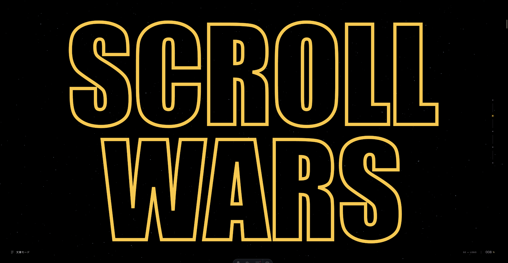

# Scroll Wars

『スター・ウォーズ』のオープニングからエンディングまでを、スクロール位置に同期させて再構成するWeb表現実験です。

Astroで各シーンのHTMLを生成し、CSS 3D Transformでタイトルとクロールを描画します。星空、月、惑星、カメラ移動はthree.js、慣性スクロールはLenisが担当します。

## シーン進行の共通実装

全シーンの進行位置は、[story.ts](./src/data/story.ts)の`sequence`に0〜1の値で定義しています。

```ts
export const sequence = {
  productionHold: 0.01,
  productionEnd: 0.02,
  introStart: 0.02,
  // ...
  rollingCreditsEnd: shiftAfterStory(0.99),
  endingStart: shiftAfterStory(0.99),
};
```

[opening.ts](./src/scripts/opening.ts)は、ページ全体のスクロール位置を`progress`へ正規化します。

```ts
progress = clamp(window.scrollY / range);
```

各シーンでは`portion()`で担当区間を0〜1へ変換し、`smoothstep()`でフェードやカメラ移動の開始・終了を滑らかにします。

```ts
const portion = (value: number, start: number, end: number) =>
  clamp((value - start) / (end - start));

const smoothstep = (value: number) =>
  value * value * (3 - 2 * value);
```

シーンのHTMLは[OpeningCrawl.astro](./src/components/OpeningCrawl.astro)に集約し、各要素を`data-*`属性で取得します。スクロールイベントは直接描画せず、`requestAnimationFrame()`によって1フレームに1回の`update()`へまとめています。

## 01 — PROLOGUE

### プロダクションクレジット

[ProductionCredit.astro](./src/components/ProductionCredit.astro)を画面中央へ固定し、`productionHold`から`productionEnd`の区間で不透明度を1から0へ変化させます。

```ts
const productionOpacity = 1 - smoothstep(
  portion(progress, sequence.productionHold, sequence.productionEnd),
);
```

透明になったあとは`visibility: hidden`と`inert`を設定し、非表示要素が操作や読み上げの対象に残らないようにしています。

### 青い導入文

[OpeningIntro.astro](./src/components/OpeningIntro.astro)の文章を、`introStart`からフェードインし、`introHold`まで保持したあと`introEnd`でフェードアウトします。

```ts
const introOpacity =
  smoothstep(portion(progress, sequence.introStart, sequence.introFadeInEnd)) *
  (1 - smoothstep(portion(progress, sequence.introHold, sequence.introEnd)));
```

フェードインとフェードアウトを乗算することで、同じ要素に「出現・静止・消失」の3段階を持たせています。

## 02 — LOGO

[OpeningTitle.astro](./src/components/OpeningTitle.astro)のタイトルを、CSSの`perspective`空間内でZ軸方向へ移動させます。

```ts
const titleProgress = portion(
  progress,
  sequence.titleStart,
  sequence.titleEnd,
);

title.style.transform =
  `translateZ(${-titleProgress * 2800}px)`;
```

文字サイズは固定値ではなく、`measure()`で実際のタイトル高と画面高を比較して決定します。これにより、画面比率が変わっても最初のタイトルがビューポートを大きく覆います。

タイトルの輪郭は[global.css](./src/styles/global.css)の`-webkit-text-stroke`で描き、塗りを透明にしています。

```css
.opening-title {
  color: transparent;
  -webkit-text-stroke: clamp(9px, 1.5vw, 24px) var(--gold);
}
```

同じ区間で宇宙背景の`--universe-opacity`も上げ、黒背景から星空へ連続して切り替えます。

## 03 — CRAWL

[OpeningStory.astro](./src/components/OpeningStory.astro)の本文を、傾けた`.crawl-plane`上でY軸方向へ移動させます。

```css
.crawl-viewport {
  perspective: var(--crawl-perspective);
  perspective-origin: 50% var(--crawl-origin);
}

.crawl-plane {
  transform: translateX(-50%) rotateX(var(--crawl-angle));
  transform-origin: 50% 0;
}
```

`measure()`は画面高から遠近法の距離と角度を計算します。消失点はデスクトップとモバイルのどちらでも画面上部20%付近に揃えます。

```ts
perspective = Math.max(360, Math.min(850, height * 0.78));
const angle = window.innerWidth <= 500 ? 57 : 62;
const originY = height * 0.2
  + perspective / Math.tan(angle * Math.PI / 180);
```

本文の移動量は、実際に計測した`crawlHeight`を基準にします。最後の段落まで奥へ消えるよう、終盤だけ8乗カーブで移動量を追加しています。

```ts
const crawlY = startY
  - (crawlHeight + startY) * crawlProgress
  - perspective * 7 * Math.pow(crawlProgress, 8);
```

上端には`mask-image`を置き、消失点へ近づいた文字を透明にします。本文が増減した場合も、`measure()`が高さを再計測して必要なスクロール距離を確保します。

## 04 — TRANSITION

### 宇宙から惑星へのカメラ移動

[starfield.ts](./src/scripts/starfield.ts)は`opening:progress`イベントを受け取り、スクロール進行度をthree.jsのカメラ座標へ変換します。

```ts
camera.position.z =
  -getCameraProgress(movement) * spaceCamera.travel;
```

クロール終了後は、`cameraPanStart`から`cameraPanEnd`の区間でカメラを下へ向けます。角度は[camera.ts](./src/data/camera.ts)の`panAngle`で管理しています。

```ts
camera.rotation.x = -pan * spaceCamera.panAngle;
```

月と惑星はそれぞれ[moons.ts](./src/scripts/moons.ts)と[planet.ts](./src/scripts/planet.ts)で`THREE.Sprite`として配置します。座標と大きさは[data/moons.ts](./src/data/moons.ts)および[data/planet.ts](./src/data/planet.ts)から調整できます。

### 円形トランジション

`irisStart`から`irisEnd`にかけて、画面対角線を基準にした円の半径を0まで縮めます。

```ts
const radius = Math.hypot(window.innerWidth, window.innerHeight)
  * 0.55 * (1 - iris);

root.style.setProperty('--iris-radius', `${radius}px`);
```

この値を`.universe`の`mask-image`へ渡し、円の内側にオープニング側の宇宙、外側にエンディング側の星空を表示します。切り替え中だけ外側へぼかしを加え、境界をなじませています。

## 05 — CREDITS

### 固定クレジット

[EndCredits.astro](./src/components/EndCredits.astro)は、`Inspired by`、制作者、使用技術の3枚を[CreditCard.astro](./src/components/CreditCard.astro)で生成します。

`creditsStart`から`creditsEnd`までをカード数で等分し、それぞれを順番にフェードイン・フェードアウトします。

```ts
const creditDuration =
  (sequence.creditsEnd - sequence.creditsStart) /
  Math.max(1, creditCards.length);

const opacity =
  smoothstep(portion(phase, 0, 0.22)) *
  (1 - smoothstep(portion(phase, 0.72, 0.95)));
```

表示中のカード本文はライブリージョンにも渡し、視覚的な切り替えと読み上げ内容を同期させています。

### ローリングクレジット

[RollingCredits.astro](./src/components/RollingCredits.astro)の`CONCEPT`と`TECHNOLOGY`をひとつの要素として画面下から上へ移動させます。`TECHNOLOGY`には、このREADMEで解説している使用技術名だけを掲載しています。

```ts
const rollTravel =
  window.innerHeight +
  rollingCreditsHeight +
  window.innerHeight * 0.08;

rollingCredits.style.transform =
  `translate(-50%, ${window.innerHeight - rollTravel * rollProgress}px)`;
```

移動距離には要素の実測値`rollingCreditsHeight`を使います。文章量が増えた場合は、`measure()`がページ全体のスクロール距離も延長します。

### 終了画面

`endingStart`以降で場面選択ナビゲーションをフェードインします。各ボタンは`scenePositions`に対応し、選択時にLenisの`scrollTo()`で該当シーンへ移動します。

終了画面が操作可能になるまでは`inert`と`pointer-events`を使って誤操作を防ぎます。

## 星空の描画

[starfield.ts](./src/scripts/starfield.ts)は、シード付き乱数で星の座標・大きさ・明るさを生成し、`THREE.Points`とカスタムシェーダーで描画します。

- 画面幅600px未満：1,020個
- 画面幅600px以上：2,160個
- ピクセル比の上限：1.75
- アンチエイリアス：無効
- 描画タイミング：スクロール、リサイズ、表示状態の変化時のみ

常時アニメーションするループは持たず、変更があったフレームだけ再描画します。タイトル側とクレジット側は同じ星のシーンを共有し、クレジット用カメラでは月と惑星を一時的に非表示にして描画します。

## 文章モードとフォールバック

文章モードでは、各シーンで使用している同じAstroコンポーネントを通常の文書フローに並べます。コピーを二重管理せず、演出表示と文章表示で内容が一致する構成です。

`prefers-reduced-motion: reduce`が有効な場合は、初期表示から文章モードを選択します。文章モードへの切り替え時にはLenisを破棄し、演出モードへ戻ると保存していた進行位置を復元します。

WebGLを初期化できない場合は、[Starfield.astro](./src/components/Starfield.astro)が生成するSVGの星空とHTML画像の月・惑星を維持します。JavaScriptが無効な場合も、演出とは別に配置した本文を読み取れます。

## 主な調整箇所

| 調整対象 | ファイル |
| --- | --- |
| 各シーンの開始・終了位置 | [src/data/story.ts](./src/data/story.ts) |
| 導入文 | [src/components/OpeningIntro.astro](./src/components/OpeningIntro.astro) |
| ロゴ | [src/components/OpeningTitle.astro](./src/components/OpeningTitle.astro) |
| クロール本文 | [src/components/OpeningStory.astro](./src/components/OpeningStory.astro) |
| 固定・ローリングクレジット | [src/components/EndCredits.astro](./src/components/EndCredits.astro)、[src/components/RollingCredits.astro](./src/components/RollingCredits.astro) |
| フェード、移動、計測 | [src/scripts/opening.ts](./src/scripts/opening.ts) |
| 星空とカメラ | [src/scripts/starfield.ts](./src/scripts/starfield.ts) |
| 月と惑星の座標 | [src/data/moons.ts](./src/data/moons.ts)、[src/data/planet.ts](./src/data/planet.ts) |
| 遠近法、色、文字組み | [src/styles/global.css](./src/styles/global.css) |

## 起動と検証

Node.js 22.12.0以上を使用します。

```sh
npm install
npm exec -- astro dev --background
```

```sh
npm exec -- astro dev status
npm exec -- astro dev logs
npm exec -- astro dev stop
npm run check
npm run build
```

本番ビルドの出力先は`dist/`です。
